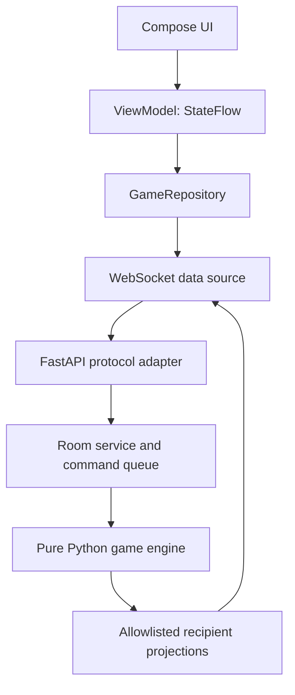

# Architecture

## Current code and planned boundaries

Phase 00 implements a FastAPI application factory and health route, plus a single
Compose Activity. Phase 01 adds pure frozen domain values and constructor
validation in `one_job/domain/`: configuration, participants/assignments, actions,
ship/round snapshots, emergency targets/records and results. Its public API is
documented in GAME_STATE.md. It imports only the Python standard library and can
be used without installed web dependencies, environment configuration or Android.
Phase 02 adds `domain/engine.py` and `rules.py`: a synchronous, single-owner
baseline with power/lane/coolant intents, fixed-step heat/hull/cooldown updates,
immutable snapshots, ordered accepted-command records and one terminal event.
It consumes no clocks, environment configuration or network libraries. Complete
simulation and live room-to-engine orchestration remain later work.

The engine receives config, integer seed, roster, assignments and round ID.
`start()` returns the running tick-zero snapshot; `apply_action()` returns a typed
accept/reject result; `tick(steps)` returns state and terminal events; `snapshot()`
and `accepted_actions` expose immutable internal values. One caller owns it and
applies commands in authoritative order before advancing whole steps. There is
no concurrent queue or scheduler in the engine. Phase 03 maps its typed action
results and snapshots to explicit boundary DTOs rather than serializing them.

Phase 03 implements `/ws` for ping/pong and structured errors. Reserved commands
are gated with `feature_unavailable` before future business decoding. The route
only delegates to a lifespan-owned `ConnectionManager`; each `create_app` lifespan
constructs its own manager, injected monotonic clock and connection settings.
Each connection supervises reader, writer, admission deadline and close signal.
Disconnect/shutdown cancels and awaits owned tasks; bounded cleanup is shielded
against ASGI level cancellation. Phase 03 introduced no room/game task.
`server/logging.json` configures allowlisted connection logs in the dev launcher.

Phase 04 adds a lifespan-owned `RoomRegistry` and one `RoomService` mailbox/owner
per room. An admission lock serializes secure code allocation and cross-room
credential lookup. Owners mutate membership/readiness and synchronously update
registry indexes on the same event loop; they never await sockets or the admission
lock. Reads/expiry pass through the owner too. Every command checks expiry before
mutation; a clock deadline wakes the owner without simulated-time sleeps. Shutdown
fences admissions, drains owners and clears rooms, digests and generation indexes.

`sessions.py` holds private bindings, token digests and bounded replay records.
An ephemeral lifespan HMAC key reconstructs opaque credentials from secure UUIDs;
cached admission receipts retain identifiers/revision, not plaintext tokens.
Normalized command hashes and terminal replies are bounded to 128/30 seconds.
Generation checks precede replay/mutation, including stale disconnect callbacks.
Targeted admission/ack replies are queued before changed snapshots. Lobby snapshots
coalesce only with the same room/type, preserving correlated/critical replies.
Start eligibility is reusable; Phase 04 itself did not construct a game engine.

Phase 08 adds a synchronous `RoundService` inside that same room owner, not a
second task. The eligible host command freezes config/participants and passes a
seeded role assignment and copied RNG state to the engine. Immutable station
metadata remains in `domain/roles.py`; `application/projections.py` constructs
allowlisted owned DTOs. Public role state contains only common round fields;
exact station values and instructions are targeted, including for the host.
The existing mailbox deadline handles the 60-second acknowledgement budget and
suspends it during disconnect grace. All acknowledgements hold in briefing with
no engine start/ticks; leave, grace expiry and briefing timeout abort. Full
private state requests/replays are scoped to a single authenticated membership.
See [ADR-017](DECISIONS.md#adr-017--private-briefing-rounds-held-before-gameplay).

`application/engine_adapter.py` accepts an explicit engine fixture and `TickSource`.
It maps three existing typed action DTOs into domain values, typed domain rejection
codes into safe errors, and public fields/percentages into `PublicRoundView`.
The baseline has no emergencies, so public warnings are empty. It creates no
tasks, and its awaited `step()` advances exactly one domain tick after a supplied
tick signal. `FixedStepTicker` is pull-driven with injected 100ms deadlines.
The socket never calls this adapter; future room ownership will orchestrate it.
Owned station projections are implemented for briefing in Phase 08; live
ticking/catch-up policy and event dispatch remain later phases. The current
public-state DTO prepares coalescing tests, not observer
admission or public broadcasts.

The arrow back to the data source represents targeted server messages. The
network layer never hands a raw engine object to a client.

## Backend

| Boundary | Owns | Must not own |
| --- | --- | --- |
| `one_job/domain/` (01–02, 08) | Dataclasses, rules, actions, deterministic ticks, seeded roles/metadata | Pydantic, asyncio, clocks, sockets, logging secrets |
| `one_job/protocol/` (03–04, 08) | Pydantic discriminated DTO unions and mapping | Mutable room/game state |
| `one_job/application/` (03–04, 08) | Connections, rooms, session credentials, commands, projections, scheduler | Rules duplicated from the engine |
| `one_job/api/` | Thin HTTP/WS routing and error translation | Ship calculations or role permissions implemented ad hoc |
| `one_job/main.py` | Dependency assembly and lifespan | Per-round business logic |

Use `create_app()` with lifespan-managed services. Start with constructor
injection, one process, one in-memory room registry. No database or Redis.
Rooms have one serialized command stream and one owner task. Socket reader tasks
validate and enqueue intents; the room owner assigns simulation ticks and applies
them. Tick and action handlers cannot mutate the same room concurrently.
Registry create/join/expire operations also require serialized ownership/locking.

Each socket gets a bounded outgoing queue (initially 32 messages). Superseded
state snapshots may be coalesced; credential responses, acknowledgements and
terminal events must not be silently dropped. Close a persistently slow consumer
and require a full snapshot on resume. Never await a slow socket inside a tick.
Lifespan shutdown cancels/awaits room and connection tasks and closes sockets.

## Time, replay and ordering

The engine advances in fixed 100 ms steps, using integer milliseconds and an
integer tick index. A wall-clock scheduler uses `time.monotonic()` outside the
engine and drains accumulated time in fixed steps. Allow at most five catch-up
ticks per scheduler turn; persistent lag aborts the round with `server_overload`
instead of changing the physics timestep. State broadcasts target 5 Hz initially.

Commands get an authoritative `(tick_index, order)` at the room boundary. At
completed-tick boundary n, apply ordered commands before continuous step n+1.
Use integers for resource units.
Round config, engine version, Python version, seed and accepted action sequence
are sufficient for same-version replay; logging just a seed is insufficient.
Use a private `random.Random(seed)` instance. Do not use UUID randomness for
gameplay. UUIDs and secure session credentials are separate infrastructure.
Cross-version bit-identical replay is not promised.

For the Phase 02 API, n means completed steps: actions recorded at boundary n
precede effects for step n+1. Accepted order is one-based across the round;
rejected actions change neither state, order nor RNG. The engine creates a private
seeded generator but does not draw from it until a later phase adds randomness.
`tests/fixtures/engine/` records engine/config/Python versions, config overrides,
seed, fixed roster/round IDs, assignments, tick-indexed commands and accepted
order. The replay harness checks every snapshot, result and event twice, then
replays accepted actions alone to prove rejected requests have no effect.

## Information boundaries

Construct `PublicRoundView` and each player's `PlayerRoundView` field by field.
The player's view includes the public view plus only their owned stations.
The host gets the same permission model. Two-player mode includes two station
views on one phone. Display mode later receives `PublicRoundView` only.
Do not attach the RNG seed, future emergency schedule, resume tokens, other
stations' detailed warnings or target instructions to shared messages.

## Android

Phase 05 uses `MainActivity` as the single host. `app/OneJobApplication.kt` owns
a small constructor-injected `AppContainer`. Phase 06 installs one application-owned
`SocketGameRepository`, exposing immutable connection/session StateFlows and typed
command results. `OkHttpSocketDataSource` owns one active socket and bounded I/O;
`ProtocolCodec` handles the typed serialization boundary. A bounded coroutine
owner serializes all credentials, pending requests, deadlines, revision filtering
and resume decisions; callbacks carry generation IDs. Rotation retains that owner;
owner closure cancels and closes it. There is no Android engine or ship simulation.

`app/OneJobApp.kt` assembles a Navigation Compose graph using the explicit
`navigation/AppDestination` enum. Routes contain no parameters or credentials.
Home opens Create/Join forms or clearly labelled future-screen previews;
navigation alone never grants membership. `ui/ShellScreens.kt` provides stateless
scrolling/inset-aware pages under the existing `ui/theme` Material 3 theme.

`ui/forms/RoomFormViewModel` receives repository, form kind and SavedStateHandle
through an ordinary navigation-entry factory. Immutable UI StateFlow combines
typed nonsecret draft inputs with repository connection status. Intents only edit
or submit validated inputs. `DraftValidation` provides presentation hints (including
Unicode character counting/ASCII code hints); server validation remains authority.
Compose collects with `collectAsStateWithLifecycle`. Only draft name/code/check
state is saved; connection status is read anew from the repository. A popped entry
discards its inputs and closes the attempt. Rejected replies retain inputs;
uncertain admission requires explicit reset rather than automatic replay.
No dependency-injection framework/use-case layer is needed.

Phase 07's shared `LobbyViewModel` maps allowlisted snapshots into ID-keyed member
presentation, local ready intent and server-hinted host start. It retains only
presentation membership during recovery; cached rosters are not retained. The
repository identity gates admission navigation; expiry/leave returns Home. Both
Back controls require leave confirmation. Feature-unavailable start remains in
Lobby. Coroutine result epochs prevent an older command from replacing leave
feedback. See ADR-016; no server or wire behavior changed.

Use one Activity. Compose screens consume immutable UI state and emit intents.
ViewModels transform repository state using coroutines and StateFlow.
The repository owns the current session and typed server snapshots; a WebSocket
data source owns one socket and bounded I/O. Use lifecycle-aware
collection; cancel work when its owner ends. Use manual app-level dependency
assembly initially, not global mutable singleton screens or a DI framework.

Navigation in Phase 05 uses explicit destinations. Server room/round state drives
the relevant destination after reconnect. Local navigation cannot start a round.
Interpolation may smooth an animation, but must not decrement authoritative hull,
invent emergency resolution or declare victory. A displayed interpolated timer
must re-anchor to server values and stop while paused/disconnected.

OkHttp WebSocket plus kotlinx.serialization implement the Phase 06 transport.
The retained debug-only connection panel emits ViewModel intents for transport
checks; Phase 07 Home instead uses the real forms. Store credentials only in private session
storage; never save them to UI state restoration bundles, logs, deep links or URLs.

## Room host, connections and deployment

Phase 08 Android `RoleViewModel` derives owned instructions/read selections from
matched repository assignment/state. It clears private presentation on recovery
and waits for the correlated full private snapshot. Each owned station must be
explicitly read before acknowledgement; server confirmation controls hold.
Navigation follows briefing/pause/abort stage and never enters gameplay locally.
No role/private snapshot or credential is saved in restored UI state.

The host is the creator's player ID. All players must be connected and ready,
with exactly 2 or 3 controllers, before start. Host checks occur on the server.
Use 30 seconds of disconnect grace. Hold the host seat during grace; on expiry
in the lobby, transfer to the earliest joined connected player, breaking ties
by player ID. Delete an empty room after grace. Idle lobby expiry is 30 minutes.
If remaining members are all disconnected, the host is temporarily null; the
first eligible resume fills that vacancy. Membership/connectivity changes clear
all ready flags. Fresh accepted lobby commands/admissions refresh idle time;
pings, rejected commands and replayed replies do not. Inbound inactivity detection
is 30 seconds, separate from the subsequent membership grace.
Finished/aborted rooms use the same membership grace and host-transfer policy;
they do not pause an already terminal simulation.

In an active round, losing a required controller pauses simulation for up to
30 seconds of monotonic wall time. Resume only after all controllers return;
expiry yields `aborted/disconnect_timeout`, not a gameplay defeat. Explicit leave
aborts immediately during briefing/countdown/running/paused. Remove explicitly
departed or grace-expired members and transfer a missing host to the earliest
joined connected player, including on the resulting aborted/results screen.
An empty room is deleted; do not leave remaining players waiting for an expired
host. Early implementations must be safe; Phase 14 hardens recovery and Android
lifecycle handling.

A process restart destroys rooms and credentials. The client returns to join/home
with a useful explanation. Run a single worker; scaling with shared ownership is
future work. WSS is required for external testing. Debug WS on a trusted LAN is
explicitly opt-in and added in Phase 06. No automatic deploy is part of a plan.

## Future scenarios

Keep spaceship rules grouped and configuration explicit. Extract scenario
interfaces only after comparing spaceship and submarine implementations in
Phase 17. Do not create a plugin loader, scenario DSL or inheritance tree now.
