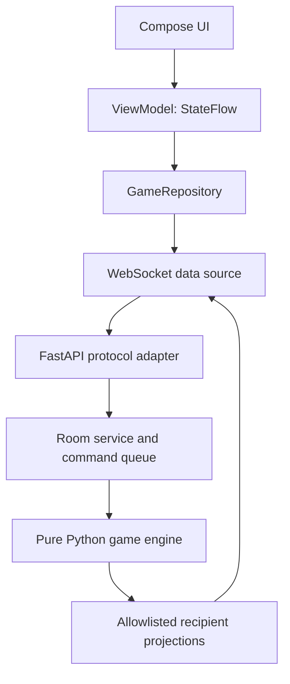

# Architecture

## Current code and planned boundaries

Phase 00 implements a FastAPI application factory and health route, plus a single
Compose Activity. Everything below describing rooms, projections and simulation
is a design contract for later phases, not existing behavior.

The arrow back to the data source represents targeted server messages. The
network layer never hands a raw engine object to a client.

## Backend

| Boundary | Owns | Must not own |
| --- | --- | --- |
| `one_job/domain/` (Phases 01–02) | Dataclasses, rules, actions, deterministic ticks | Pydantic, asyncio, clocks, sockets, logging secrets |
| `one_job/protocol/` (03) | Pydantic discriminated DTO unions and mapping | Mutable room/game state |
| `one_job/application/` (03–04) | Connections, rooms, session credentials, commands, projections, scheduler | Rules duplicated from the engine |
| `one_job/api/` | Thin HTTP/WS routing and error translation | Ship calculations or role permissions implemented ad hoc |
| `one_job/main.py` | Dependency assembly and lifespan | Per-round business logic |

Use `create_app()` with lifespan-managed services. Start with constructor
injection, one process, one in-memory room registry. No database or Redis.
Rooms have one serialized command stream and one owner task. Socket reader tasks
validate and enqueue intents; the room owner assigns simulation ticks and applies
them. Tick and action handlers cannot mutate the same room concurrently.
Registry create/join/expire operations also require serialized ownership/locking.

Each socket gets a bounded outgoing queue (initially 32 messages). Superseded
state snapshots may be coalesced; credential responses, acknowledgements and
terminal events must not be silently dropped. Close a persistently slow consumer
and require a full snapshot on resume. Never await a slow socket inside a tick.
Lifespan shutdown cancels/awaits room and connection tasks and closes sockets.

## Time, replay and ordering

The engine advances in fixed 100 ms steps, using integer milliseconds and an
integer tick index. A wall-clock scheduler uses `time.monotonic()` outside the
engine and drains accumulated time in fixed steps. Allow at most five catch-up
ticks per scheduler turn; persistent lag aborts the round with `server_overload`
instead of changing the physics timestep. State broadcasts target 5 Hz initially.

Commands get an authoritative `(tick_index, order)` at the room boundary and are
applied before that tick's continuous effects. Use integers for resource units.
Round config, engine version, Python version, seed and accepted action sequence
are sufficient for same-version replay; logging just a seed is insufficient.
Use a private `random.Random(seed)` instance. Do not use UUID randomness for
gameplay. UUIDs and secure session credentials are separate infrastructure.
Cross-version bit-identical replay is not promised.

## Information boundaries

Construct `PublicRoundView` and each player's `PlayerRoundView` field by field.
The player's view includes the public view plus only their owned stations.
The host gets the same permission model. Two-player mode includes two station
views on one phone. Display mode later receives `PublicRoundView` only.
Do not attach the RNG seed, future emergency schedule, resume tokens, other
stations' detailed warnings or target instructions to shared messages.

## Android

Use one Activity. Compose screens consume immutable UI state and emit intents.
ViewModels transform repository state using coroutines and StateFlow.
The repository owns the current session and typed server snapshots; a WebSocket
data source owns one socket, serialization and bounded I/O. Use lifecycle-aware
collection; cancel work when its owner ends. Use manual app-level dependency
assembly initially, not global mutable singleton screens or a DI framework.

Navigation in Phase 05 uses explicit destinations. Server room/round state drives
the relevant destination after reconnect. Local navigation cannot start a round.
Interpolation may smooth an animation, but must not decrement authoritative hull,
invent emergency resolution or declare victory. A displayed interpolated timer
must re-anchor to server values and stop while paused/disconnected.

OkHttp WebSocket plus kotlinx.serialization is the planned Phase 06 transport.
Add those dependencies only then. Store credentials only in private session
storage; never save them to UI state restoration bundles, logs, deep links or URLs.

## Room host, connections and deployment

The host is the creator's player ID. All players must be connected and ready,
with exactly 2 or 3 controllers, before start. Host checks occur on the server.
Use 30 seconds of disconnect grace. Hold the host seat during grace; on expiry
in the lobby, transfer to the earliest joined connected player, breaking ties
by player ID. Delete an empty room after grace. Idle lobby expiry is 30 minutes.
Finished/aborted rooms use the same membership grace and host-transfer policy;
they do not pause an already terminal simulation.

In an active round, losing a required controller pauses simulation for up to
30 seconds of monotonic wall time. Resume only after all controllers return;
expiry yields `aborted/disconnect_timeout`, not a gameplay defeat. Explicit leave
aborts immediately during briefing/countdown/running/paused. Remove explicitly
departed or grace-expired members and transfer a missing host to the earliest
joined connected player, including on the resulting aborted/results screen.
An empty room is deleted; do not leave remaining players waiting for an expired
host. Early implementations must be safe; Phase 14 hardens recovery and Android
lifecycle handling.

A process restart destroys rooms and credentials. The client returns to join/home
with a useful explanation. Run a single worker; scaling with shared ownership is
future work. WSS is required for external testing. Debug WS on a trusted LAN is
explicitly opt-in and added in Phase 06. No automatic deploy is part of a plan.

## Future scenarios

Keep spaceship rules grouped and configuration explicit. Extract scenario
interfaces only after comparing spaceship and submarine implementations in
Phase 17. Do not create a plugin loader, scenario DSL or inheritance tree now.
