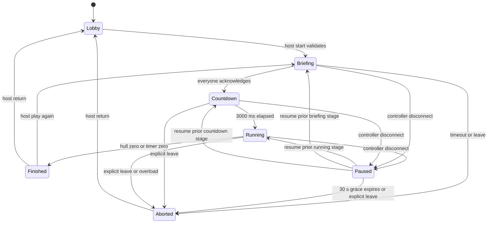

# State, terminology and lifecycle

Phase 01 implements immutable, validated Python domain values in
`server/src/one_job/domain/`. Rules that advance or mutate a round, room services
and wire projections remain later work. Wire field names live in
NETWORK_PROTOCOL.md; internal snapshots are not serialization contracts.

| Term | Meaning / owner |
| --- | --- |
| `PlayerId` / `RoundId` | Nominal UUID value types in `domain/types.py`; callers supply IDs, transport later converts UUID strings |
| `Player` | Frozen round participant (`player_id`, trimmed name); application membership later owns join order, connection and ready state |
| `RoomCode` | Six symbols from `ABCDEFGHJKLMNPQRSTUVWXYZ23456789`; discovery only |
| `Room` | Membership, host ID, room revision, current session; application layer |
| `Role` | Station: `pilot`, `engineer`, `shields` |
| `RoleAssignment` | Frozen participant IDs plus a copied, read-only `Role → PlayerId` mapping; exactly one owner per station |
| `GameSession` | Planned application context grouping round/config/engine/participants; not implemented |
| `GameEngine` | Planned Phase 02 synchronous simulation with seeded RNG; not implemented |
| `GameState` | Frozen internal snapshot of config, participants, assignments, ship, round and active emergencies |
| `ShipSystem` | Conceptual subsystem; do not require a base class in Phase 01 |
| `GameConfig` | Validated frozen settings in `domain/config.py`; single source of provisional balance defaults |
| `PlayerAction` | Union of nine frozen action records in `domain/actions.py`; no actor identity or execution |
| `Emergency` | Supplied positive round-local `EmergencyId`, typed target, start/deadline ticks, progress, status and optional finished tick; kind derives from target |
| `EmergencyType` | Asteroid, overheating or shield overload in initial gameplay |
| `EmergencyState` | `active`, `resolved` or `failed` |
| `RoundState` | Supplied round ID, stage, duration, tick index, pause/countdown metadata and optional result; elapsed/remaining milliseconds are derived |
| `GameResult` | Frozen outcome/reason, survived milliseconds, raw final hull, counts and participant roster; final hull percentage is derived |

## Ownership and identifiers

Room/session credentials and connection generations are application-layer data,
never engine state. A player can own multiple stations. A display has a separate
observer identity and no station or host permissions. Membership names are trimmed,
1–20 Unicode characters, with control characters rejected. Duplicate names are
allowed; identity and permissions always use player IDs.

`PlayerId` and `RoundId` wrap `uuid.UUID` using `NewType`; constructors reject raw
strings, numbers and booleans. The domain neither generates IDs nor authenticates
them. `EmergencyId` is a positive integer supplied by the future engine, suitable
for deterministic round-local ordering. No wire ID encoding is introduced here.

Room codes are uppercase and case-normalized on input. Generate with secure
randomness and retry collisions atomically; cap retries at 10 and return capacity
error. IDs and room codes are not game RNG outputs. A new rematch gets a new
round ID and seed; room code, player IDs and host stay stable.

## Implemented Python API

The package root exports `GameConfig`, `GameState`, `Player`, `PlayerAction`,
`PlayerId`, `Role`, `RoleAssignment`, `RoundState` and `ShipState`. Import concrete
actions from `one_job.domain.actions`; enums/IDs from `one_job.domain.types`;
cooldowns, emergency targets and results from `one_job.domain.models`.

```python
from uuid import UUID

from one_job.domain import (
    GameConfig, GameState, Player, PlayerId, Role, RoleAssignment, RoundState, ShipState,
)
from one_job.domain.types import RoundId

config = GameConfig()
ids = (PlayerId(UUID(int=1)), PlayerId(UUID(int=2)))
players = (Player(ids[0], "Crew A"), Player(ids[1], "Crew B"))
assignments = RoleAssignment(
    ids, {Role.PILOT: ids[0], Role.ENGINEER: ids[1], Role.SHIELDS: ids[1]},
)
state = GameState(
    config=config,
    players=players,
    assignments=assignments,
    ship=ShipState.from_config(config),
    round=RoundState(RoundId(UUID(int=10)), duration_ms=config.round_duration_ms),
)
assert state.assignments.roles_for(ids[1]) == (Role.ENGINEER, Role.SHIELDS)
assert state.tick_index == 0 and state.elapsed_ms == 0
```

Callers supply assignments: three participants own one station each; two split
Pilot / Engineer+Shields. Duplicate IDs, missing stations, foreign owners and other
two-player combinations are rejected. Duplicate names are valid. Seeded selection
of owners is Phase 08; the model only validates an explicit assignment.

All records are frozen slotted dataclasses. Input participant/emergency sequences
are copied to tuples; assignment mappings are copied before exposing a read-only
view. Updating a value with `dataclasses.replace` constructs a new validated value
without changing an existing snapshot. Numeric fields require actual integers;
booleans, floating-point values and numeric strings are rejected. Enum fields
require their declared enum, with no implicit string conversion.

`ShipState` validates raw bounds and nonnegative remaining ticks. `GameState`
additionally checks roster agreement, configured duration, effect/cooldown limits,
the configured power budget, result hull/roster agreement and active emergency
capacity/IDs/kinds/windows. `ShipState.available_power(config)` derives the budget
without changing state. It can be negative for a standalone ship paired with an
incompatible config; composing that pair into `GameState` is rejected.

Action records expose fixed `kind` and owning `role` class metadata. Their
constructor parameters match the action parameter domains in the protocol:

| Record | Constructor parameters | Station |
| --- | --- | --- |
| `MoveLane` | `direction: MoveDirection.LEFT or RIGHT` | Pilot |
| `Evade` | None | Pilot |
| `SetEnginePower` | `value: int`, 0–100 | Engineer |
| `EngineBoost`, `Coolant`, `EmergencyShutdown` | None | Engineer |
| `SetShield` | Required `active: bool`, `facing: ShieldFacing` | Shields |
| `RechargeShield`, `ShieldBoost` | None | Shields |

Actions contain no actor/player ID and do not apply themselves. Stage, station
permission, resource and cooldown checks when executing them belong to the future
engine. No parser, socket DTO or arbitrary action dictionary is added.

`Emergency.target` is an `AsteroidTarget(impact_lane, required_facing)`,
`OverheatingTarget(max_output, max_temperature)` or
`ShieldOverloadTarget(max_output, hold_ticks)`. This fixes its kind without
unrelated nullable fields. A shield overload always means deactivate shields;
there is no independent mutable deactivate flag. Start/deadline/finished ticks
and consecutive progress are validated, including no finished tick while active
and a deadline tick for failure. `GameState.emergencies` contains active records
only; completed counts live in `GameResult`. Terminal records can be constructed
separately. Constructors do not schedule events or evaluate resolution predicates.

`RoundStage` covers briefing/countdown/running/paused/finished/aborted. Lobby is
application membership state and has no round snapshot. Gameplay tick zero is
required before running, including pauses of briefing/countdown. A pause remembers
an active prior stage; countdown milliseconds exist only during countdown or its
pause. Nonterminal rounds cannot have results or expired gameplay timers.

`GameResult` pairs victory with `survived`, defeat with `hull_destroyed`, and abort
with `disconnect_timeout`, `player_left`, `briefing_timeout` or `server_overload`.
Victory/abort require surviving hull; defeat requires zero hull. Briefing timeout
has zero simulated survival time. Composing a terminal round checks matching
elapsed time and outcome: victory requires exactly the configured duration, while
abort cannot replace an expired timer. Hull destruction at timer expiration is
a valid defeat. These are value invariants; no terminal transition is executed.

## Authoritative ship model

Use integer quantities for reproducible arithmetic. Display percentages are
derived values and should not be separately mutable.

| State | Initial value / range | Visibility |
| --- | --- | --- |
| Hull | 1000 / 0–1000 | Public percentage |
| Shield energy | 600 / 0–1000 | Public percentage; exact units to Shields |
| Shield facing | `front` / front, left, right, rear | Shields private |
| Shield active | false | Shields private |
| Engine output | 40 / 0–100 | Engineer private |
| Engine temperature | 300 / 0–1000 | Engineer exact; shared critical warning |
| Navigation lane | `center` / left, center, right | Pilot private |
| Available power | Derived from output and active consumers | Engineer private; local low-power indicator |
| Cooldowns | Remaining integer ticks per action | Owning station only |
| Active emergencies | Internal deadlines, required targets, progress | Public warning labels; per-station details |
| Round time | 90,000 ms initially / configured 60,000–120,000 | Public |

Power is a derived budget: generation = output; shield hold costs 15, recharge
costs 20 and boost costs 25 while active. A request that would exceed budget is
rejected atomically rather than partially applied. Additional equations and
durations are in GAME_DESIGN.md. Bounds/invariants are validated on construction
and maintained through engine transitions.

## Lifecycle



`finished` contains victory/defeat; `aborted` contains an abort reason. UI calls
both results. Pause remembers the prior stage and timers. Briefing has a 60-second
wall-time acknowledgement limit, suspended during disconnect grace. Countdown
advances server orchestration time; gameplay ticks and emergency timers begin
only at running. No actions are accepted before running or while paused/terminal.
`play_again` requires connected/ready players and works after finished/aborted;
aborted can also return to briefing via rematch once conditions hold. It never
resurrects a departed player's assignment. On explicit departure or grace expiry,
remove the membership and transfer a missing host among remaining connected
players even if the round just aborted. A rematch with fewer than two is rejected;
the host can return to lobby and admit another player.

At a running tick, process ordered commands, continuous resource changes,
emergency resolution/failure, then terminal checks. Hull <= 0 takes precedence
over timer expiration on the same tick. Once terminal, further ticks/actions do
not mutate the result. Clamp public values at bounds, without hiding invalid
input before validation. Engine actions are all-or-nothing.

## Revisions and snapshots

Every externally visible room mutation increments a monotonically increasing
`room_revision` within that room, including stage/connection changes. Multiple
targeted views of one mutation carry the same revision. A running state projection
also has `round_id`, `tick_index` and elapsed milliseconds. Never compare revisions
across different rooms. On resume, clear old cached views and request a full view;
a newer round ID replaces all previous round-specific controls and cooldowns.

## Projection shape

`PublicRoundView`: round ID/stage, tick, time remaining, hull/shield percentages,
public emergency labels/IDs and terminal summary. `PlayerRoundView`: public view
plus a dictionary containing only the recipient's owned station views. The seed,
future events, internal required predicates and credential records are never sent.

Full snapshots are preferred over deltas for the MVP. Test absence of forbidden
fields as well as presence of expected ones. Snapshot equality for replay excludes
infrastructure IDs or injects stable IDs into tests.
