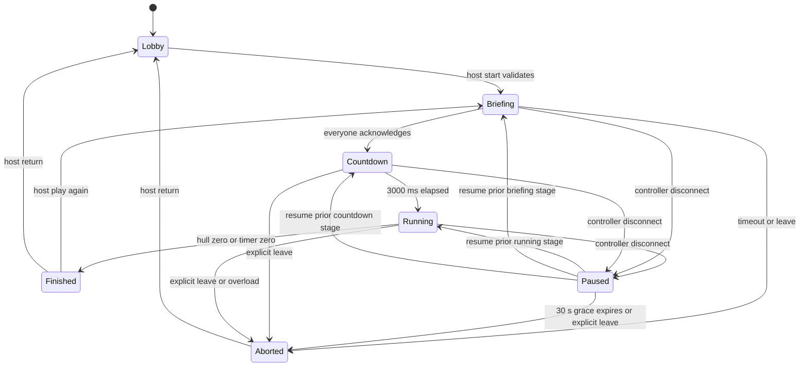

# State, terminology and lifecycle

Phase 01 implements immutable, validated Python domain values in
`server/src/one_job/domain/`. Phase 02 adds the synchronous baseline engine
described below. Phase 04 implements application room membership/lobby projections;
Phase 08 adds seeded ownership and private projections; Phase 09 connects full
controls, the room runner and owned control panels. Wire field
names live in
NETWORK_PROTOCOL.md; internal snapshots are not serialization contracts.

| Term | Meaning / owner |
| --- | --- |
| `PlayerId` / `RoundId` | Nominal UUID value types in `domain/types.py`; callers supply IDs, transport later converts UUID strings |
| `Player` | Frozen round participant (`player_id`, trimmed name); application membership later owns join order, connection and ready state |
| `RoomCode` | Six symbols from `ABCDEFGHJKLMNPQRSTUVWXYZ23456789`; discovery only |
| `Room` | Membership, host ID, room revision, current session; application layer |
| `Role` | Station: `pilot`, `engineer`, `shields` |
| `RoleAssignment` | Frozen participant IDs plus a copied, read-only `Role → PlayerId` mapping; exactly one owner per station |
| `RoundService` | Phase 08 synchronous application context grouping round/config/seed/engine/frozen participants and briefing acknowledgement; existing room task owns it |
| `GameEngine` | Phase 02 single-owner synchronous baseline: start, three actions, heat/damage, cooldowns, fixed ticks and terminal results |
| `GameState` | Frozen internal snapshot of config, participants, assignments, ship, round and active emergencies |
| `ShipSystem` | Conceptual subsystem; do not require a base class in Phase 01 |
| `GameConfig` | Validated frozen settings in `domain/config.py`; single source of provisional balance defaults |
| `PlayerAction` | Union of nine frozen action records in `domain/actions.py`; no actor identity or execution |
| `Emergency` | Supplied positive round-local `EmergencyId`, typed target, start/deadline ticks, progress, status and optional finished tick; kind derives from target |
| `EmergencyType` | Asteroid, overheating or shield overload in initial gameplay |
| `EmergencyState` | `active`, `resolved` or `failed` |
| `RoundState` | Supplied round ID, stage, duration, tick index, pause/countdown metadata and optional result; elapsed/remaining milliseconds are derived |
| `GameResult` | Frozen outcome/reason, survived milliseconds, raw final hull, counts and participant roster; final hull percentage is derived |

## Ownership and identifiers

Room/session credentials and connection generations are application-layer data,
never engine state. A player can own multiple stations. A display has a separate
observer identity and no station or host permissions. Membership names are trimmed,
1–20 Unicode characters, with control characters rejected. Duplicate names are
allowed; identity and permissions always use player IDs.

`PlayerId` and `RoundId` wrap `uuid.UUID` using `NewType`; constructors reject raw
strings, numbers and booleans. The domain neither generates IDs nor authenticates
them. `EmergencyId` is a positive integer supplied by the future engine, suitable
for deterministic round-local ordering. No wire ID encoding is introduced here.

Room codes are uppercase and case-normalized on input. Generate with secure
randomness and retry collisions atomically; cap retries at 10 and return capacity
error. IDs and room codes are not game RNG outputs. A new rematch gets a new
round ID and seed; room code, player IDs and host stay stable.

## Phase 04 lobby lifecycle

Application membership is separate from immutable domain `Player` values.
`RoomRegistry` discovers rooms and credentials; each `RoomService` task owns its
roster, host ID, ready flags, revision and deadlines. Six-symbol room codes are
securely generated with ten collision attempts; UUIDs identify memberships.
Duplicate names never share identity. Configurable defaults are 100 rooms and
three controller seats; two players can satisfy start eligibility.

Create/join/resume send targeted session credentials then full allowlisted lobby
state. Membership/connectivity mutations reset all readiness and increment the
revision once. Readiness no-ops/replayed requests do not increment it. The host is
the creator, holds its seat through disconnect grace, and transfers to the earliest
joined connected member on leave/expiry. If none is connected, host ID is null
until an eligible resume. Exact-deadline expiry precedes resume/other commands.
Disconnected seats reserve capacity for 30 seconds; empty rooms are removed.
Lobbies expire after 30 minutes without fresh accepted room activity; heartbeats,
errors and cached replies do not refresh that idle deadline.

The stable opaque credential is reconstructed only for targeted transmission;
registry membership and replay records contain no plaintext token. Resume replaces
the old connection generation before accepting subsequent commands. Old commands
and disconnect callbacks cannot mutate the replacement. Per-member terminal replay
is bounded to 128 entries/30 seconds. Explicit leave, expiry and restart invalidate
credentials. See NETWORK_PROTOCOL.md and ADR-014 for wire/replay details.

`start_eligibility` requires lobby stage and exactly two or three connected ready
members. `start_game` also requires the host but still returns
`feature_unavailable` after valid checks. No game/role/observer session is created.

## Implemented Python API

The package root exports `GameEngine`, `GameConfig`, `GameState`, `Player`, `PlayerAction`,
`PlayerId`, `Role`, `RoleAssignment`, `RoundState` and `ShipState`. Import concrete
actions from `one_job.domain.actions`; enums/IDs from `one_job.domain.types`;
cooldowns, emergency targets and results from `one_job.domain.models`.

```python
from uuid import UUID

from one_job.domain import (
    GameConfig, GameState, Player, PlayerId, Role, RoleAssignment, RoundState, ShipState,
)
from one_job.domain.types import RoundId

config = GameConfig()
ids = (PlayerId(UUID(int=1)), PlayerId(UUID(int=2)))
players = (Player(ids[0], "Crew A"), Player(ids[1], "Crew B"))
assignments = RoleAssignment(
    ids, {Role.PILOT: ids[0], Role.ENGINEER: ids[1], Role.SHIELDS: ids[1]},
)
state = GameState(
    config=config,
    players=players,
    assignments=assignments,
    ship=ShipState.from_config(config),
    round=RoundState(RoundId(UUID(int=10)), duration_ms=config.round_duration_ms),
)
assert state.assignments.roles_for(ids[1]) == (Role.ENGINEER, Role.SHIELDS)
assert state.tick_index == 0 and state.elapsed_ms == 0
```

Callers supply assignments: three participants own one station each; two split
Pilot / Engineer+Shields. Duplicate IDs, missing stations, foreign owners and other
two-player combinations are rejected. Duplicate names are valid. Seeded selection
of owners is Phase 08; the model only validates an explicit assignment.

All records are frozen slotted dataclasses. Input participant/emergency sequences
are copied to tuples; assignment mappings are copied before exposing a read-only
view. Updating a value with `dataclasses.replace` constructs a new validated value
without changing an existing snapshot. Numeric fields require actual integers;
booleans, floating-point values and numeric strings are rejected. Enum fields
require their declared enum, with no implicit string conversion.

`ShipState` validates raw bounds and nonnegative remaining ticks. `GameState`
additionally checks roster agreement, configured duration, effect/cooldown limits,
the configured power budget, result hull/roster agreement and active emergency
capacity/IDs/kinds/windows. `ShipState.available_power(config)` derives the budget
without changing state. It can be negative for a standalone ship paired with an
incompatible config; composing that pair into `GameState` is rejected.

Action records expose fixed `kind` and owning `role` class metadata. Their
constructor parameters match the action parameter domains in the protocol:

| Record | Constructor parameters | Station |
| --- | --- | --- |
| `MoveLane` | `direction: MoveDirection.LEFT or RIGHT` | Pilot |
| `Evade` | None | Pilot |
| `SetEnginePower` | `value: int`, 0–100 | Engineer |
| `EngineBoost`, `Coolant`, `EmergencyShutdown` | None | Engineer |
| `SetShield` | Required `active: bool`, `facing: ShieldFacing` | Shields |
| `RechargeShield`, `ShieldBoost` | None | Shields |

Actions contain no actor/player ID and do not apply themselves. The Phase 02
engine checks stage, station ownership, values, resources and cooldowns for its
three supported actions. The other six records remain unavailable for execution.
No parser, socket DTO or arbitrary action dictionary is added.

`Emergency.target` is an `AsteroidTarget(impact_lane, required_facing)`,
`OverheatingTarget(max_output, max_temperature)` or
`ShieldOverloadTarget(max_output, hold_ticks)`. This fixes its kind without
unrelated nullable fields. A shield overload always means deactivate shields;
there is no independent mutable deactivate flag. Start/deadline/finished ticks
and consecutive progress are validated, including no finished tick while active
and a deadline tick for failure. `GameState.emergencies` contains active records
only; completed counts live in `GameResult`. Terminal records can be constructed
separately. Constructors do not schedule events or evaluate resolution predicates.

`RoundStage` covers briefing/countdown/running/paused/finished/aborted. Lobby is
application membership state and has no round snapshot. Gameplay tick zero is
required before running, including pauses of briefing/countdown. A pause remembers
an active prior stage; countdown milliseconds exist only during countdown or its
pause. Nonterminal rounds cannot have results or expired gameplay timers.

`GameResult` pairs victory with `survived`, defeat with `hull_destroyed`, and abort
with `disconnect_timeout`, `player_left`, `briefing_timeout` or `server_overload`.
Victory/abort require surviving hull; defeat requires zero hull. Briefing timeout
has zero simulated survival time. Composing a terminal round checks matching
elapsed time and outcome: victory requires exactly the configured duration, while
abort cannot replace an expired timer. Hull destruction at timer expiration is
a valid defeat. Model constructors check these value invariants; the engine below
executes the baseline transitions.

## Phase 02 engine API

`GameEngine(config, seed, players, assignments, *, round_id)` accepts a strict
integer seed, an explicit participant roster/assignment and a caller-supplied
round ID. It owns a private `random.Random(seed)`. No IDs, role assignments or
random events are generated. Participant sequences are frozen at construction;
there are no membership/reconfiguration methods. `GameEngine` is exported from
the package root; result/event types and `ENGINE_VERSION` live in `domain/engine.py`.

| Method / property | Behavior |
| --- | --- |
| `snapshot() → GameState` | Immutable internal snapshot; safe to retain while the engine replaces its current state |
| `start() → GameState` | Briefing to running at tick zero; repeated starts raise `ValueError` |
| `apply_action(actor_id, action) → ActionResult` | Applies all nine station actions immediately, in caller order |
| `tick(steps=1) → TickResult` | Positive integer count of 100 ms steps; stops at the first terminal tick |
| `accepted_actions` | Immutable tuple of `ActionApplied(tick_index, order, actor_id, action)` records |

An `ActionResult` has `code`, derived `accepted`, and `events`. Accepted commands
return code `accepted` with exactly one `ActionApplied`; rejections have no events
and leave snapshots, accepted-order history and RNG unchanged. Rejection codes are
`invalid_stage`, `not_participant`, `invalid_action`, `feature_unavailable`,
`not_role_owner`, `insufficient_power`, `cooldown` and `lane_boundary`.
The engine checks stage, then participant, known/supported shape, typed arguments,
ownership and action constraints. Phase 09 executes the entire action union;
`feature_unavailable` remains a compatibility code but no catalog action emits it.
Unknown/malformed actions return `invalid_action`. Transport maps domain codes
explicitly, including `lane_boundary` to the safe wire `invalid_action`.

The snapshot's `tick_index=n` counts completed steps. Commands at boundary `n`
are applied in call order before effects for step `n+1`. Their trace uses boundary
`n` and a round-wide, one-based accepted `order`; rejected commands consume no
order. The caller drains its ordered commands before calling `tick()`. There is
no queue, socket, ticker or wall-clock scheduler inside the engine.

Each step applies base/boost heat and clamps temperature, then critical heat
damage/hull clamping, combined shield energy gains/drain and zero-energy release,
then evaluates existing emergencies, ages all durations/cooldowns, advances the tick and checks terminal
conditions. A cooldown set to C at boundary n becomes legal
again at boundary n+C. Thus a move at zero is unavailable after one step and
available after two; coolant becomes available after 30 default steps.

`TickResult.state` is the new snapshot and `TickResult.events` contains one
`RoundEnded(result)` only on the transition to terminal, plus ordered
`EmergencyChanged` lifecycle events. Hull destruction wins
over time expiration on the same step. Subsequent valid ticks return the same
terminal snapshot with no events, and actions return `invalid_stage`. Invalid
step counts (zero, negative, bool, float/nonfinite or string) and ticking before
start raise `ValueError` without mutation. There is no delta-time API.

The original Phase 02 heat/hull behavior remains. Phase 09 adds evade, boosts,
shutdown, facing/activation and recharge/energy dynamics under the documented
power reservations. Phase 10 adds the pure seeded `EmergencyScheduler` and
`advance_emergencies` state machines. Existing events resolve/fail by ID before
terminal checks; if still running, threshold overheat and the due scheduled slot
may start events. Engine-local counters enter `GameResult` on finish/abort.
The scheduler owns its next slot/ID, not a wall clock. Its state/seed never enters
transport projections. Pause freezes it and terminal calls cannot draw RNG.
Explicit `GameConfig(emergencies_enabled=False)` preserves core-only replay
fixtures. Production defaults enable emergencies (`spaceship-v2`, engine v3).

Snapshots, action traces and engine events are internal data, not public/player
projections. Never serialize or broadcast these full objects. Phase 03 adapts
this API; Phase 08 implements private projections and Phase 09 live running.

## Phase 08 role and briefing API

`domain.roles.assign_roles(players, rng)` validates a join-ordered frozen roster
of two or three unique `Player`s before drawing. It shuffles a copy of player IDs
with the supplied `random.Random`: first gets Pilot, second Engineer, third
Shields; with two players the second gets Engineer+Shields. The resulting
`RoleAssignment.player_ids` preserves join order. `StationMetadata` is a frozen
role/title/steps value and `STATIONS` is an immutable mapping separate from ship
rules. Metadata has one to four short, nonblank instructions.

`application.round_service.RoundService` is synchronously owned by the existing
room mailbox. An eligible host start freezes config/roster, creates a round UUID
and seed, performs assignment and gives the engine a private copy of the RNG's
post-assignment state. After the last acknowledgement Phase 11 calls
`begin_countdown()` and arms the room runner; Phase 08's held state and Phase 09's
direct `start()` remain usable by historical pure-engine fixtures.
`GameEngine.authorize_action(actor_id, action)` checks all nine action shapes and
station ownership without mutation. The authenticated socket supplies actor ID;
client role/player claims are forbidden. `pause()`, `resume()` and
`abort(ResultReason)` preserve tick zero and immutable snapshots; abort retains
the original participant names/IDs in its public result.

`application.projections.assigned_view` returns only the recipient's role names
and metadata. `player_view` returns the common `PublicRoundView`, only that
participant's typed station views and `BriefingStatus`; it never returns an
internal snapshot, seed, ownership table or another station's exact values.
The two-station participant receives exactly Engineer and Shields. Host status
does not change projection access. See [the wire contract](NETWORK_PROTOCOL.md).

The application tracks acknowledgement by frozen player ID, not by current host
or phone-selected tab. It accepts `briefing_ready(round_id)` for all owned roles;
Android requires an explicit read confirmation on each owned station first.
The acknowledgement budget starts at 60 seconds and freezes during disconnect
grace. It resumes only when every original participant is connected. All ready
now means countdown with no briefing deadline. Explicit leave,
expired grace and expired briefing abort visibly with
`player_left`, `disconnect_timeout` and `briefing_timeout` respectively. The
in-memory terminal round is stable until replacement, lobby return or room removal.

## Phase 11 countdown and session loop

`GameEngine.begin_countdown()` transitions briefing to countdown with 3000ms.
`advance_countdown(elapsed_ms)` requires a positive integer, consumes only
countdown time, clamps at zero and discards overshoot on entry to running tick
zero. Neither call changes resources, cooldowns, emergency state, action order or
RNG. They do not read clocks. The room runner supplies 100ms steps and publishes
countdown at 5Hz plus immediate stage transitions. Pause freezes the last completed
step; resume uses a fresh origin and cannot accumulate paused time. The existing
five-step overload guard applies in countdown too. `tick()` retains the unchanged
running rules and hull-before-timer precedence; no engine/replay version changes.

Terminal broadcast includes the stable allowlisted result and one critical
`game_over`; recovery obtains a full snapshot without replaying the event.
Explicit terminal readiness enables host `play_again` for 2/3 connected members.
Replacement constructs a fresh context before mutating the old one, suspends its
runner, resets readiness/sequence/action/cooldown/event state and uses a different
seed and UUID. Factory collisions retry at most eight times and otherwise preserve
the old terminal state. `return_to_lobby` clears the round/readiness. Only the
previous round's ID/seed are retained for collision protection; no history grows.
Cached private state replies are discarded when a round is cleared/replaced.

## Phase 09 runner and action boundary

`RoomRunner` is synchronous scheduling policy inside the existing room task. An
injected monotonic clock wakes it at 100ms boundaries; it does not create another
mutable owner. Commands dispatched that turn precede continuous effects and
record `(completed tick, accepted order)`. At most five catch-up ticks run per
turn; a second consecutive turn owing more than five aborts `server_overload`.
Pause suspends scheduling; resume uses the current completed tick and a fresh
wall-time origin, discarding paused time rather than catching it up.

Snapshots target 5Hz and contain only the recipient's owned station details plus
common public state. Tick/action mutations advance revision even between
snapshots. Terminal state is immediate, critical and stops scheduling. Socket
offers are bounded/nonblocking; slow writers never run inside simulation.
`RoundService.submit_action` enforces current round and per-player monotonic
sequence, then authenticated engine ownership/stage/rules. Typed current-round
attempts consume sequence on rejection too; cached request replay occurs first.
Stale-round requests do not consume current sequence. No action is automatically
resent. Accepted trace events map to `ack` with sequence/applied tick; failures
map to `action_rejected`. The server alone determines victory/defeat/abort.

## Authoritative ship model

Use integer quantities for reproducible arithmetic. Display percentages are
derived values and should not be separately mutable.

| State | Initial value / range | Visibility |
| --- | --- | --- |
| Hull | 1000 / 0–1000 | Public percentage |
| Shield energy | 600 / 0–1000 | Public percentage; exact units to Shields |
| Shield facing | `front` / front, left, right, rear | Shields private |
| Shield active | false | Shields private |
| Engine output | 40 / 0–100 | Engineer private |
| Engine temperature | 300 / 0–1000 | Engineer exact; shared critical warning |
| Navigation lane | `center` / left, center, right | Pilot private |
| Available power | Derived from output and active consumers | Engineer private; local low-power indicator |
| Cooldowns | Remaining integer ticks per action | Owning station only |
| Active emergencies | Internal deadlines, required targets, progress | Public warning labels; per-station details |
| Round time | 90,000 ms initially / configured 60,000–120,000 | Public |

Power is a derived budget: generation = output; shield hold costs 15, recharge
costs 20 and boost costs 25 while active. A request that would exceed budget is
rejected atomically rather than partially applied. Additional equations and
durations are in GAME_DESIGN.md. Bounds/invariants are validated on construction
and maintained through engine transitions.

## Lifecycle



`finished` contains victory/defeat; `aborted` contains an abort reason. UI calls
both results. Pause remembers the prior stage and timers. Briefing has a 60-second
wall-time acknowledgement limit, suspended during disconnect grace. Countdown
advances server orchestration time; gameplay ticks and emergency timers begin
only at running. No actions are accepted before running or while paused/terminal.
`play_again` requires connected/ready players and works after finished/aborted;
aborted can also return to briefing via rematch once conditions hold. It never
resurrects a departed player's assignment. On explicit departure or grace expiry,
remove the membership and transfer a missing host among remaining connected
players even if the round just aborted. A rematch with fewer than two is rejected;
the host can return to lobby and admit another player.

At a running tick, process ordered commands, continuous resource changes,
emergency resolution/failure, then terminal checks. Hull <= 0 takes precedence
over timer expiration on the same tick. Once terminal, further ticks/actions do
not mutate the result. Clamp public values at bounds, without hiding invalid
input before validation. Engine actions are all-or-nothing.

## Revisions and snapshots

Every externally visible room mutation increments a monotonically increasing
`room_revision` within that room, including stage/connection changes. Multiple
targeted views of one mutation carry the same revision. A running state projection
also has `round_id`, `tick_index` and elapsed milliseconds. Never compare revisions
across different rooms. On resume, clear old cached views and request a full view;
a newer round ID replaces all previous round-specific controls and cooldowns.

The private full snapshot also carries the receiving player's consumed
`last_client_action_seq` (including rejected current-round attempts). This
infrastructure counter does not change simulation rules. Correlated full private
snapshots may refresh an equal room revision, because a rejection can consume a
sequence without a ship mutation. Unsolicited duplicate kinds, older revisions
and retired rounds remain filtered. A new process merges this server counter;
uncertain actions and unsent UI input are never replayed. Only the minimal
credential/endpoint/identity binding survives in Android's private no-backup file;
all station/public snapshots must be recovered afresh. Background suspension and
host/display policy are specified in the [interruption matrix](INTERRUPTION_MATRIX.md).

## Projection shape

`PublicRoundView`: round ID/stage, tick, time remaining, hull/shield percentages,
public emergency labels/IDs and terminal summary. `PlayerRoundView`: public view
plus a dictionary containing only the recipient's owned station views. The seed,
future events, internal required predicates and credential records are never sent.

Full snapshots are preferred over deltas for the MVP. Test absence of forbidden
fields as well as presence of expected ones. Snapshot equality for replay excludes
infrastructure IDs or injects stable IDs into tests.
