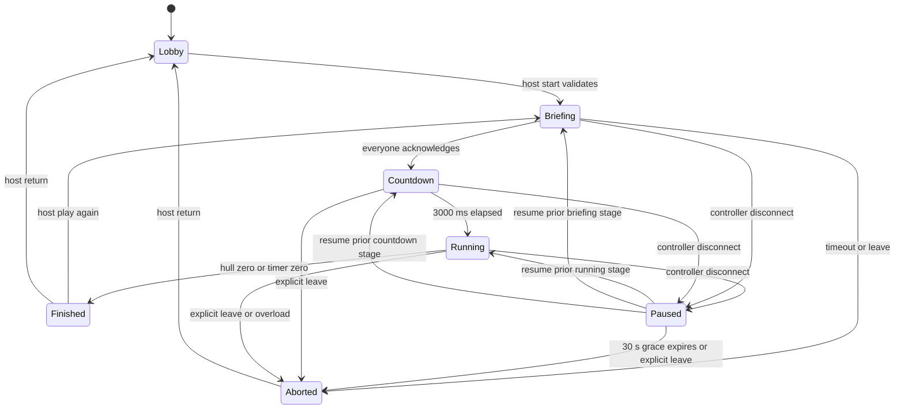

# State, terminology and lifecycle

This is the intended model vocabulary. Phase 01 introduces domain classes;
Phase 00 does not implement them. Wire field names live in NETWORK_PROTOCOL.md.

| Term | Meaning / owner |
| --- | --- |
| `PlayerId` | Server-issued UUID string, stable for one room membership |
| `Player` | Name, join order, connection/ready state; no account |
| `RoomCode` | Six symbols from `ABCDEFGHJKLMNPQRSTUVWXYZ23456789`; discovery only |
| `Room` | Membership, host ID, room revision, current session; application layer |
| `Role` | Station: `pilot`, `engineer`, `shields` |
| `RoleAssignment` | Round-local station-to-player mapping; exactly one owner per station |
| `GameSession` | Round ID, config, engine and participant roster |
| `GameEngine` | Synchronous pure simulation with its own seeded RNG |
| `GameState` | Authoritative snapshot of round, ship, roles and emergencies |
| `ShipSystem` | Conceptual subsystem; do not require a base class in Phase 01 |
| `GameConfig` | Validated immutable rules and balance values |
| `PlayerAction` | Typed station intent, with identity supplied by authenticated server context |
| `Emergency` | ID, kind, start/deadline ticks, progress and status |
| `EmergencyType` | Asteroid, overheating or shield overload in initial gameplay |
| `EmergencyState` | `active`, `resolved` or `failed` |
| `RoundState` | Stage, elapsed simulated time, remaining time and optional result |
| `GameResult` | `victory`, `defeat` or `aborted`, with reason and public summary |

## Ownership and identifiers

Room/session credentials and connection generations are application-layer data,
never engine state. A player can own multiple stations. A display has a separate
observer identity and no station or host permissions. Membership names are trimmed,
1–20 Unicode characters, with control characters rejected. Duplicate names are
allowed; identity and permissions always use player IDs.

Room codes are uppercase and case-normalized on input. Generate with secure
randomness and retry collisions atomically; cap retries at 10 and return capacity
error. IDs and room codes are not game RNG outputs. A new rematch gets a new
round ID and seed; room code, player IDs and host stay stable.

## Authoritative ship model

Use integer quantities for reproducible arithmetic. Display percentages are
derived values and should not be separately mutable.

| State | Initial value / range | Visibility |
| --- | --- | --- |
| Hull | 1000 / 0–1000 | Public percentage |
| Shield energy | 600 / 0–1000 | Public percentage; exact units to Shields |
| Shield facing | `front` / front, left, right, rear | Shields private |
| Shield active | false | Shields private |
| Engine output | 40 / 0–100 | Engineer private |
| Engine temperature | 300 / 0–1000 | Engineer exact; shared critical warning |
| Navigation lane | `center` / left, center, right | Pilot private |
| Available power | Derived from output and active consumers | Engineer private; local low-power indicator |
| Cooldowns | Remaining integer ticks per action | Owning station only |
| Active emergencies | Internal deadlines, required targets, progress | Public warning labels; per-station details |
| Round time | 90,000 ms initially / configured 60,000–120,000 | Public |

Power is a derived budget: generation = output; shield hold costs 15, recharge
costs 20 and boost costs 25 while active. A request that would exceed budget is
rejected atomically rather than partially applied. Additional equations and
durations are in GAME_DESIGN.md. Bounds/invariants are validated on construction
and maintained through engine transitions.

## Lifecycle

`finished` contains victory/defeat; `aborted` contains an abort reason. UI calls
both results. Pause remembers the prior stage and timers. Briefing has a 60-second
wall-time acknowledgement limit, suspended during disconnect grace. Countdown
advances server orchestration time; gameplay ticks and emergency timers begin
only at running. No actions are accepted before running or while paused/terminal.
`play_again` requires connected/ready players and works after finished/aborted;
aborted can also return to briefing via rematch once conditions hold. It never
resurrects a departed player's assignment. On explicit departure or grace expiry,
remove the membership and transfer a missing host among remaining connected
players even if the round just aborted. A rematch with fewer than two is rejected;
the host can return to lobby and admit another player.

At a running tick, process ordered commands, continuous resource changes,
emergency resolution/failure, then terminal checks. Hull <= 0 takes precedence
over timer expiration on the same tick. Once terminal, further ticks/actions do
not mutate the result. Clamp public values at bounds, without hiding invalid
input before validation. Engine actions are all-or-nothing.

## Revisions and snapshots

Every externally visible room mutation increments a monotonically increasing
`room_revision` within that room, including stage/connection changes. Multiple
targeted views of one mutation carry the same revision. A running state projection
also has `round_id`, `tick_index` and elapsed milliseconds. Never compare revisions
across different rooms. On resume, clear old cached views and request a full view;
a newer round ID replaces all previous round-specific controls and cooldowns.

## Projection shape

`PublicRoundView`: round ID/stage, tick, time remaining, hull/shield percentages,
public emergency labels/IDs and terminal summary. `PlayerRoundView`: public view
plus a dictionary containing only the recipient's owned station views. The seed,
future events, internal required predicates and credential records are never sent.

Full snapshots are preferred over deltas for the MVP. Test absence of forbidden
fields as well as presence of expected ones. Snapshot equality for replay excludes
infrastructure IDs or injects stable IDs into tests.
