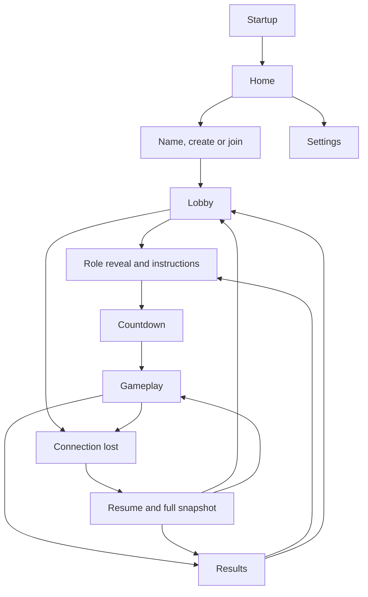

# UI, navigation and interaction

Phase 07 binds usable create/join/lobby screens to the Phase 06 repository.
Phase 08 adds private server-assigned briefing; Phase 09 adds live owned control
panels. Phase 11 adds authoritative countdown, Results and host rematch/lobby return.
Use Material 3 and ordinary phone layouts before final visual design. A portrait
layout is the first target; preserve state on rotation and do not lock orientation
as a substitute for lifecycle handling.

## Navigation

### Current Phase 11 control flow

Home opens Create/Join. Forms validate
name/code hints, normalize the submitted values and call the shared repository.
Only a server-admitted identity opens Lobby. Rejected requests retain typed inputs;
pending requests disable repeated submission. An uncertain admission shows that
the command may have happened, requires an explicit clear-attempt action and
never retries itself. Back cancels the attempt and closes transport, or leaves
if admission already succeeded. System Back and the visible Back control return to Home.
The former debug transport panel is no longer rendered on Home; its debug source
remains available. Normal forms now exercise the real admission flow.

| Destination | Implemented contents / state |
| --- | --- |
| Home | Title, Create/Join and session-end feedback |
| Create | Name, validation, pending/error/uncertainty feedback, actual Create |
| Join | Name/six-symbol code, normalization, retained errors and actual Join |
| Lobby | Large room code, ID-keyed roster, host/you markers, connected/ready labels, local Ready, host Start and confirmed Leave |
| Role | Own assigned station metadata, explicit read/acknowledgement, dual-station switch, hold/pause/abort and confirmed Leave |
| Countdown | Server-provided 3/2/1, owned station titles, pause/recovery, confirmed Leave; no controls or local timer |
| Gameplay | Server time/hull/shield strip, owned Pilot/Engineer/Shields controls, typed action feedback and pause/recovery |
| Results | Stable outcome/reason/survival/hull/event counts/frozen crew, current readiness, host Play again/Return to lobby, recovery and confirmed Leave |

Create/Join have separate navigation-entry ViewModels. Name/code/check state is
saved through `SavedStateHandle` and survives activity recreation/rotation. Popping
the form cancels its attempt and removes its entry/draft.
Raw nonsecret typed inputs are retained while checking trimmed/case-insensitive
values. No session credential, pending command or authoritative snapshot is saved.
State is collected with lifecycle awareness; network I/O stays in the repository.

Lobby readiness changes only from a server snapshot. Duplicate names remain
separate members keyed by player ID; only the local member has a Ready control.
Start requires the local host and server `can_start`, and disabled Start explains
whether it needs players, connectivity, readiness or a server update. A valid
start opens Role only from the authoritative briefing stage/private snapshots.
Both system Back and Leave ask for confirmation. Expiry/
removal returns Home. Recovery clears the roster, disables commands and waits for
the fresh snapshot without duplicating members. Leave also works during recovery.

`RoleViewModel` consumes the repository's matched owned assignment/state; Compose
never chooses roles or derives ownership from host status. Only owned station
buttons and the selected station's two short instructions are rendered. The
Engineer+Shields participant switches between both; each must be explicitly
marked read below its instructions before the acknowledgement button enables.
No private numeric control panel is rendered in this phase. Acknowledgement is
pending until server state confirms it, and repeated taps cannot send duplicates.

Phase 11 transitions completed briefing through Countdown to Gameplay.
Countdown displays the ceiling of server milliseconds/1000; neither clock runs
locally. Phase 08's held-briefing text is
retained for historical fixture/testing compatibility.
Pause explains that both briefing and deadline are suspended for reconnect.
Recovery clears private metadata/read selections until a matching fresh private
snapshot arrives; server acknowledgement survives resume. An abort, including
briefing timeout, opens Results from a matching full snapshot. Membership and
recovery routes derive from server stage/round ID; Back never silently abandons
a room. A one-shot `game_over` cannot invent a result or drive navigation.

Every terminal member explicitly readies again. Host Play again enables only
with the server's current eligibility; Return to lobby needs the current host and
terminal stage. Pending commands disable repeat submission, with no optimistic
stage/readiness changes. Fresh briefing clears old results/private views and
read confirmations; lobby return clears readiness. Recovery retains the route
while hiding stale private presentation, then restores from the new snapshot.

Phase 08 device, private-frame and timeout evidence is recorded in
[ROLE_SYSTEM_VALIDATION.md](ROLE_SYSTEM_VALIDATION.md).

### Phase 09 controls

`GameplayViewModel` accepts only matched owned metadata/station snapshots and
emits typed intents. It never calculates heat, energy, power, accepted lane or an
outcome. The public strip uses server remaining time and percentages; it does
not decrement between frames. Pilot has large left/right/evade buttons. Engineer
has accepted output/heat/free power, a 0–100 slider and boost/coolant/shutdown.
Shields has exact energy/facing, active toggle, facing selectors and recharge/
boost. Each control renders server cooldowns; local enable hints do not replace
server permission/resource checks. Rejections are safe, explicit feedback.

Engineer/Shields switches preserve ownership. Inactive tabs retain attention
badges for server-provided instruction entries. Phase 10 renders shared labels
and only the selected owned station's urgent instructions, including the server's
remaining milliseconds. The client never runs an emergency clock or success rule.
Only the latest server lifecycle kind/status is retained as shared text feedback;
full snapshots own warning visibility. Slider draft is labelled requested output and reconciles
with the accepted snapshot. It has one in-flight request and one conflated latest
value, at most 10 sends per second. Shutdown discards queued prior output so a
stale drag cannot turn the engine back on. Repository-owned sequences survive
ViewModel replacement/resume. Buttons guard repeated pending intents.

Disconnect/round/stage changes invalidate queued intents and clear stale private
presentation. No action queue is replayed. A server pause disables controls and
explains frozen time; resume restores the fresh private snapshot. A server terminal
result now opens the Results screen. Phase 09 evidence remains in
[CORE_GAMEPLAY_VALIDATION.md](CORE_GAMEPLAY_VALIDATION.md); Phase 11 evidence and
deferred physical-phone verification are in
[ROUND_LIFECYCLE_VALIDATION.md](ROUND_LIFECYCLE_VALIDATION.md).

The existing Material 3 light/dark theme is retained. Pages use system/IME insets,
a centered maximum content width and vertical scrolling without fixed text
heights. The shell was inspected in portrait/landscape and at font scale 2.0;
larger content remains reachable by scrolling. This is functional foundation UI,
not the final game presentation.

Phase 07 screenshot/behavior evidence is recorded in
[LOBBY_UI_VALIDATION.md](LOBBY_UI_VALIDATION.md). Ignored local captures include
the two-client eligible host response, recovery without stale members, and the
lobby/leave dialog at font scale 2.0. These are functional Material 3 screens;
no final visual design or completed round is claimed.

### Planned connected navigation

The actual resume destination is derived from server stage; briefing/countdown
can also be resumed. Home settings initially need only local preferences once
their features exist. Startup should use the platform splash rather than add an
artificial waiting screen. Back from lobby asks before leaving membership; back
from gameplay offers leave confirmation. Canceling that dialog keeps the session.
Do not replace server leave semantics with local navigation.
Those membership dialogs apply to the live lobby, not the session-free previews.

## Screen contract

| Screen / phase | Main contents | Action and state rules |
| --- | --- | --- |
| Home (00; expanded 05/07) | Name of game, status; later Create/Join | Phase 00 has truthful placeholder text, no dead multiplayer buttons |
| Name/create/join (07) | Name 1–20 chars; six-character code on join | Inline validation; disable repeated submit while pending; retain typed inputs on server error |
| Lobby (07) | Large room code, roster, connected/ready labels, host marker | Ready toggle; host Start enabled only on eligibility; show why unavailable |
| Reveal/briefing (08) | Owned stations and short primary-control instructions | Acknowledge all owned stations; show which teammates are waiting, not their private instructions |
| Countdown (11) | Large 3, 2, 1 and role identity | No controls accepted until running; server timing |
| Gameplay (09) | Public hull/time, private station controls and urgent cue | No menus over urgent controls; show server rejection with a short reason |
| Results (11) | Team outcome, survival time, resolved/failed count | All ready explicitly; host Play again / Return to lobby; confirmed Leave |
| Reconnecting (06/14) | Connection state, grace explanation, Retry / Leave | Disable gameplay controls; do not retain an unsent action queue |
| Public display (12) | Public timer, hull/shield, warning labels, outcome | No role controls or private instruction data even in hidden widgets |
| Settings (13+) | Audio, haptics, reduced motion | Local only; persisted preferences cannot affect game rules |

## Rough gameplay layout

| Region | Pilot | Engineer | Shields |
| --- | --- | --- | --- |
| Top strip | Time / hull / connection | Time / hull / connection | Time / hull / connection |
| Main information | Lane and impact-lane cue | Heat gauge, output and free power | Shield energy and protected facing |
| Primary controls | Large left / right | Output slider with numeric value | Facing selectors and active switch |
| Secondary row | Evade + cooldown | Coolant / boost / shutdown | Recharge / boost + cooldowns |
| Warning area | Impact deadline | Heat/power instructions | Protection/overload instructions |

Two-station players get an Engineer/Shields tab switch above the main information.
An urgent badge remains visible for the inactive tab. Switching does not send an
action or change server ownership. Public state is a small shared strip, not a
replacement for private station information.

## Interaction and access

Use at least 48 dp touch targets, readable type, system insets and high contrast.
Do not rely solely on color, flashing or sound to convey urgency. Pair role color
with a text label/icon; support TalkBack names and logical traversal. At large font
sizes, controls must remain reachable; avoid fixed-height text containers.
Critical warnings use short text and a countdown where that station is entitled
to know it. Avoid paragraphs and decorative animation during play.

Slider position may update locally while dragging, but its displayed accepted
value is reconciled with the server. Conflate/throttle output requests to no more
than 10/second. Display a pending change until a snapshot or rejection settles it.
Buttons show cooldown/readiness from role state; a local enable hint never replaces
server checks. Settings and menu sounds must not drown out people talking.

Connection overlays distinguish connecting, connected, reconnecting, expired and
server unavailable. No spin loop without an explanation or exit. Backgrounding
and rotation should not create duplicate sockets. Future audio/haptics honor
local settings and pause while the app is not visible.
