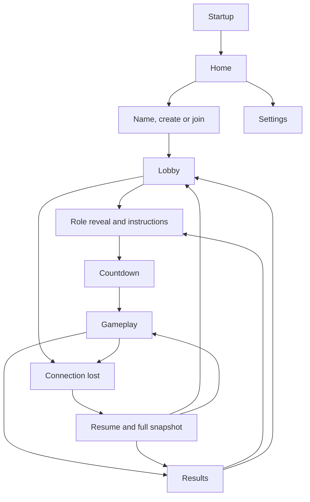

# UI, navigation and interaction

Only the foundation home screen exists in Phase 00. Screens below are planned.
Use Material 3 and ordinary phone layouts before final visual design. A portrait
layout is the first target; preserve state on rotation and do not lock orientation
as a substitute for lifecycle handling.

## Navigation

The actual resume destination is derived from server stage; briefing/countdown
can also be resumed. Home settings initially need only local preferences once
their features exist. Startup should use the platform splash rather than add an
artificial waiting screen. Back from lobby asks before leaving membership; back
from gameplay offers leave confirmation. Canceling that dialog keeps the session.
Do not replace server leave semantics with local navigation.

## Screen contract

| Screen / phase | Main contents | Action and state rules |
| --- | --- | --- |
| Home (00; expanded 05/07) | Name of game, status; later Create/Join | Phase 00 has truthful placeholder text, no dead multiplayer buttons |
| Name/create/join (07) | Name 1–20 chars; six-character code on join | Inline validation; disable repeated submit while pending; retain typed inputs on server error |
| Lobby (07) | Large room code, roster, connected/ready labels, host marker | Ready toggle; host Start enabled only on eligibility; show why unavailable |
| Reveal/briefing (08) | Owned stations and short primary-control instructions | Acknowledge all owned stations; show which teammates are waiting, not their private instructions |
| Countdown (11) | Large 3, 2, 1 and role identity | No controls accepted until running; server timing |
| Gameplay (09) | Public hull/time, private station controls and urgent cue | No menus over urgent controls; show server rejection with a short reason |
| Results (11) | Team outcome, survival time, resolved/failed count | Host Play again / Return to lobby; others wait or leave |
| Reconnecting (06/14) | Connection state, grace explanation, Retry / Leave | Disable gameplay controls; do not retain an unsent action queue |
| Public display (12) | Public timer, hull/shield, warning labels, outcome | No role controls or private instruction data even in hidden widgets |
| Settings (13+) | Audio, haptics, reduced motion | Local only; persisted preferences cannot affect game rules |

## Rough gameplay layout

| Region | Pilot | Engineer | Shields |
| --- | --- | --- | --- |
| Top strip | Time / hull / connection | Time / hull / connection | Time / hull / connection |
| Main information | Lane and impact-lane cue | Heat gauge, output and free power | Shield energy and protected facing |
| Primary controls | Large left / right | Output slider with numeric value | Facing selectors and active switch |
| Secondary row | Evade + cooldown | Coolant / boost / shutdown | Recharge / boost + cooldowns |
| Warning area | Impact deadline | Heat/power instructions | Protection/overload instructions |

Two-station players get an Engineer/Shields tab switch above the main information.
An urgent badge remains visible for the inactive tab. Switching does not send an
action or change server ownership. Public state is a small shared strip, not a
replacement for private station information.

## Interaction and access

Use at least 48 dp touch targets, readable type, system insets and high contrast.
Do not rely solely on color, flashing or sound to convey urgency. Pair role color
with a text label/icon; support TalkBack names and logical traversal. At large font
sizes, controls must remain reachable; avoid fixed-height text containers.
Critical warnings use short text and a countdown where that station is entitled
to know it. Avoid paragraphs and decorative animation during play.

Slider position may update locally while dragging, but its displayed accepted
value is reconciled with the server. Conflate/throttle output requests to no more
than 10/second. Display a pending change until a snapshot or rejection settles it.
Buttons show cooldown/readiness from role state; a local enable hint never replaces
server checks. Settings and menu sounds must not drown out people talking.

Connection overlays distinguish connecting, connected, reconnecting, expired and
server unavailable. No spin loop without an explanation or exit. Backgrounding
and rotation should not create duplicate sockets. Future audio/haptics honor
local settings and pause while the app is not visible.
